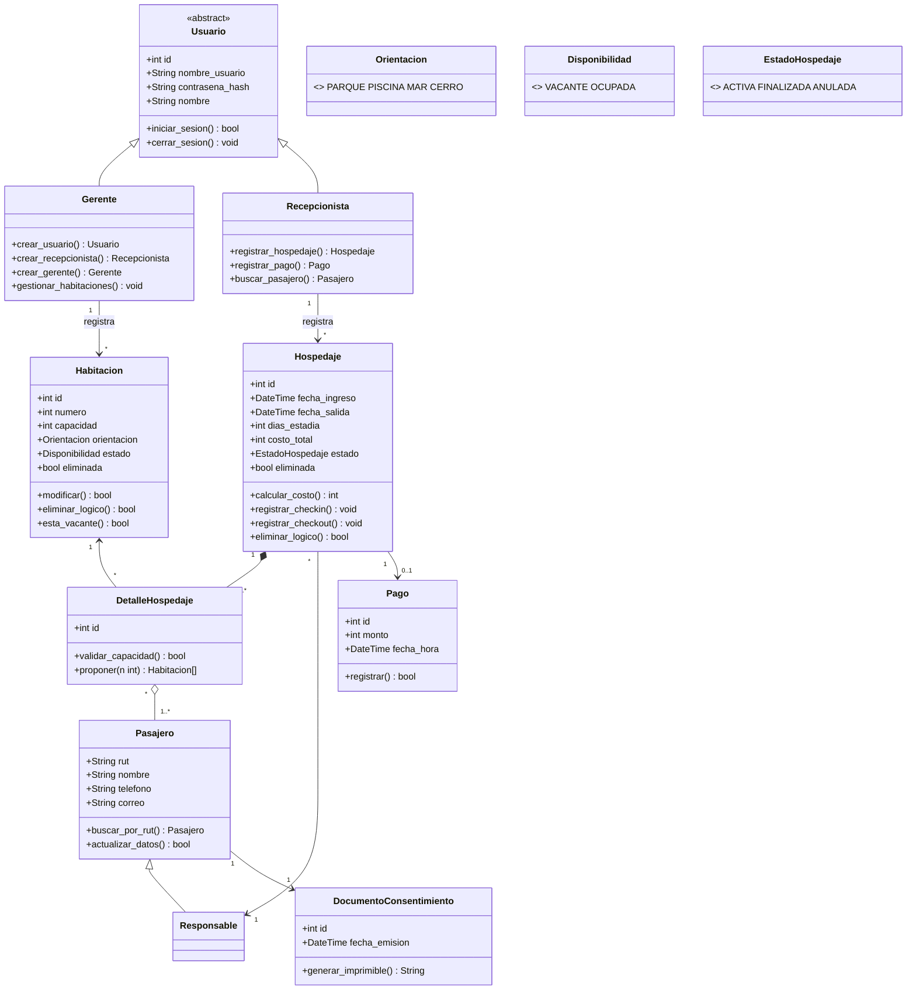
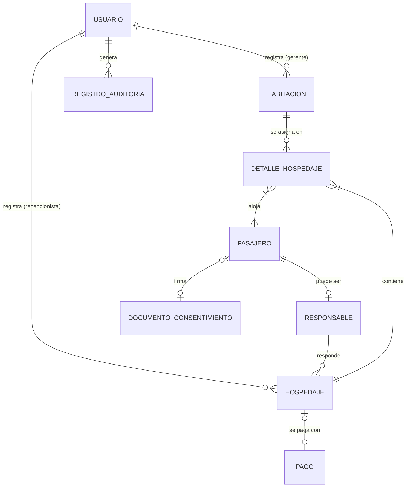
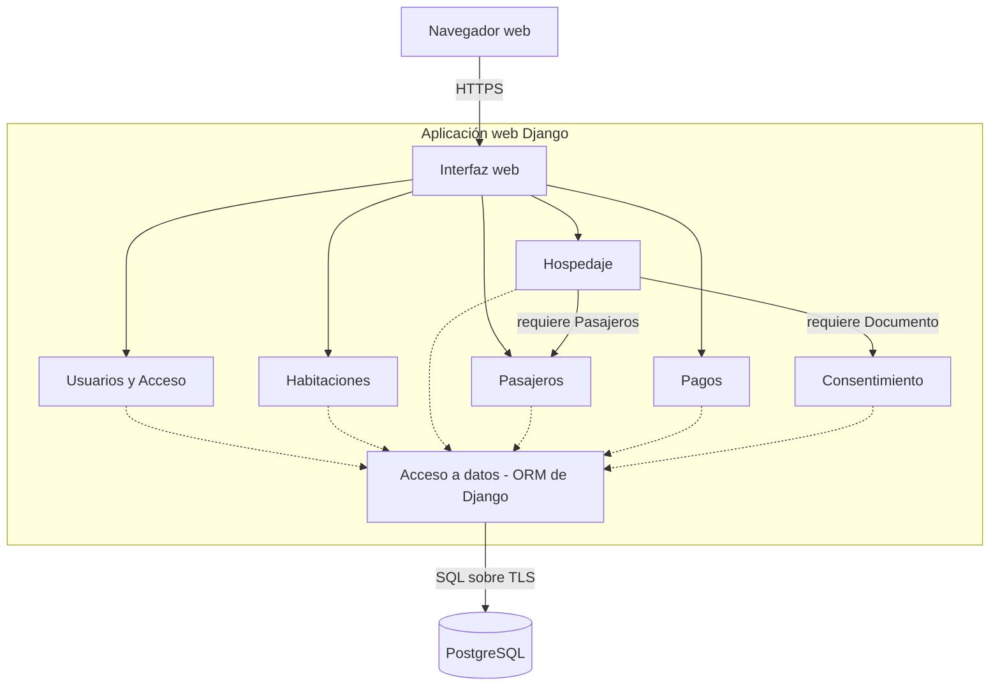

# Hotel El Aura: resumen técnico para comenzar el desarrollo

> Documento de traspaso para un agente de programación (Claude Code). Resume las decisiones tomadas, las reglas de negocio, los diagramas principales, los archivos del proyecto y los pendientes.
> Estado: proyecto académico (informes 1 y 2 en curso). Idioma de trabajo: **español** (interfaz, nombres de dominio y comentarios).
> Los diagramas de este archivo están en Mermaid solo como **referencia textual**. Los diagramas oficiales son los de UML 2.5.1 y BPMN 2.0 del proyecto (ver sección 11). Si hay diferencias, mandan los oficiales.

---

## 1. Qué se está construyendo

Sistema web para el **Hotel El Aura** que reemplaza las planillas Excel de registro de pasajeros y habitaciones.

- El hotel **no tiene reservas con anticipación**: el cliente llega y solicita alojamiento en el lugar. Por eso el concepto central se llama **hospedaje** (el docente indicó que "reserva" confunde; ver pendiente P1).
- Usuarios del sistema: **gerente** y **recepcionista**. El cliente **no** tiene acceso al sistema.
- El flujo básico: buscar o crear pasajeros por RUT → registrar días de estadía → el sistema propone habitaciones → el recepcionista confirma y define al responsable → se calcula y se informa el precio → el cliente acepta, firma el consentimiento y paga → check-in → check-out automático al cumplirse la estadía.

## 2. Decisiones técnicas

| Tema | Decisión |
|---|---|
| Arquitectura | **Monolito Django** con patrón MTV (plantillas del servidor), con JavaScript puntual (por ejemplo, filtrar tablas). Se descartó Django REST Framework + React: el alcance, el equipo y la cantidad de usuarios internos no lo justifican. |
| Base de datos | **PostgreSQL**, con el ORM de Django y migraciones. Modelo relacional (datos estructurados). |
| Infraestructura | **Heroku** (app web, Heroku Postgres, Config Vars, Pipelines con etapa de *staging*, Heroku Scheduler para el check-out automático). |
| Django | **5.1 o superior** (las restricciones usan `condition=`). |
| Contraseñas | Hasher por defecto de Django (PBKDF2) como respaldo y **Argon2id** como primero (`django[argon2]`). Ver sección 8. |
| Dinero | Pesos chilenos como **entero** (`PositiveIntegerField`). Nunca `float`. |
| Metodología | Scrum, priorización MoSCoW, historias de usuario con criterios de aceptación. |
| Seguridad | OWASP ASVS 5.0 (nivel 1; nivel 2 en autenticación, autorización y datos personales) y OWASP Top 10:2025. Ley 19.628 y Ley 21.719 (verificar la fecha de vigencia de esta última antes de citarla). |
| Pruebas | `pytest-django`, Bandit, `pip-audit`, OWASP ZAP, Locust. |

## 3. Roles y permisos

Los perfiles son **excluyentes**: una cuenta es gerente o recepcionista, nunca ambos. Se implementa con un campo `rol` en `Usuario` (no hay tablas separadas).

| Función | Gerente | Recepcionista |
|---|:---:|:---:|
| Iniciar y cerrar sesión | ✔ | ✔ |
| Crear, modificar y eliminar (lógicamente) habitaciones | ✔ | ✖ |
| Registrar recepcionistas y gerentes | ✔ | ✖ |
| Consultar estado de habitaciones e historial de una habitación | ✔ (lectura) | ✔ |
| Consultar pasajeros hospedados e historial de pasajeros | ✔ (lectura) | ✔ |
| Buscar pasajero por RUT, registrar hospedaje, proponer y confirmar habitaciones, definir responsable, ver costo | ✖ | ✔ |
| Anular hospedaje (sin check-in), generar consentimiento, registrar pago y check-in | ✖ | ✔ |
| Check-out | automático (Reloj del sistema) | automático |

Principios: mínimo privilegio, **denegación por defecto** (una vista sin permiso declarado no es accesible) y separación de funciones.

## 4. Reglas de negocio

- **RN01.** Cada habitación tiene una **capacidad** (en el documento original aparecía como "tipo") y una **orientación**: parque, piscina, mar o cerro.
- **RN02.** La tarifa es **$20.000 por pasajero por día**, no por habitación. `costo_total = pasajeros × dias_estadia × TARIFA_POR_PASAJERO_DIA`. La tarifa es una constante en `settings`; el `costo_total` se guarda en el hospedaje y queda fijo.
- **RN03.** La cantidad de pasajeros asignados a cada habitación debe ser **exactamente su capacidad**.
- **RN04.** El sistema **propone** las habitaciones priorizando la **mayor capacidad disponible** (por ejemplo, grupo de 5 con una habitación de 3: se propone esa y una de 2). El **recepcionista confirma** y puede ajustar la propuesta (por ejemplo, 4 pasajeros como 3+1 o 2+2). Si no hay propuesta posible, el proceso termina sin hospedaje.
- **RN05.** **No hay reservas futuras.** El hospedaje se registra cuando el cliente ya está en el hotel.
- **RN06.** Antes de registrar a un pasajero se **busca por RUT**: si existe se **recupera**, si no se **crea**. Un pasajero existe una sola vez y puede aparecer en muchos hospedajes.
- **RN07.** El **responsable** es un pasajero y **siempre se hospeda**. Debe estar entre los pasajeros del propio hospedaje.
- **RN08.** El hospedaje se **concreta** cuando el cliente conoce el precio, **acepta**, firma el consentimiento y **paga**. En ese momento se hace el **check-in**. Si el cliente no acepta, el hospedaje se **anula** y las habitaciones quedan vacantes.
- **RN09.** El **pago es obligatorio** para confirmar el hospedaje y lo registra el recepcionista a nombre del responsable.
- **RN10.** El **check-out es automático** al cumplirse el plazo de estadía y libera las habitaciones.
- **RN11.** Solo se puede **anular** un hospedaje **sin check-in** (sin pago).
- **RN12.** **Eliminación lógica**: habitaciones y hospedajes no se borran, se marcan `eliminada` para conservar el historial.
- **RN13.** El **consentimiento de datos personales** es un documento imprimible asociado a cada pasajero. Nace al momento de hospedarse (Ley de protección de datos).
- **RN14.** Las habitaciones tienen estado **Vacante** u **Ocupada**. Una habitación pasa a ocupada al registrar el hospedaje (queda retenida) y vuelve a vacante al anular o al hacer check-out.
- **RN15.** El número de habitación es **único entre habitaciones no eliminadas**.
- **RN16.** Nunca puede quedar el sistema **sin gerente activo**: el último gerente no puede eliminarse ni degradarse.
- **RN17.** El RUT se guarda **normalizado** (sin puntos, con guion y la K en mayúscula) y se valida con el dígito verificador (módulo 11).
- **RN18.** Toda acción relevante deja un registro de **auditoría** (usuario, acción, entidad, fecha, IP), sin contraseñas ni RUT completo.

## 5. Requisitos y historias de usuario (referencia)

**Requisitos funcionales (20).** Los títulos conservan la numeración vigente. Donde dice "reserva" léase "hospedaje" (ver P1).

| ID | Título |
|---|---|
| RF01 | Registro de habitaciones |
| RF02 | Modificación de habitaciones |
| RF03 | Eliminación lógica de habitaciones |
| RF04 | Registro de huéspedes, días de estadía y fecha (incluye la regla de capacidad exacta y la búsqueda por RUT) |
| RF05 | Reserva (hospedaje) de múltiples habitaciones |
| RF06 | Propuesta de habitaciones según disponibilidad |
| RF07 | Pasajero responsable |
| RF08 | Cálculo del costo |
| RF09 | Eliminación (anulación) de reservas sin check-in |
| RF10 | Interfaz de pago (simulada: una plantilla de Django, sin pasarela real) |
| RF11 | Check-in |
| RF12 | Check-out |
| RF13 | Resumen de estado de habitaciones |
| RF14 | Resumen de pasajeros hospedados |
| RF15 | Autenticación |
| RF16 | Registro de recepcionistas |
| RF17 | Registro de gerentes |
| RF18 | Exclusividad de perfiles |
| RF19 | Acceso restringido de clientes |
| RF20 | Documento de consentimiento de datos personales |

**Requisitos no funcionales (8):** RNF01 Seguridad de acceso, RNF02 Protección de datos, RNF03 Trazabilidad, RNF04 Usabilidad, RNF05 Rendimiento, RNF06 Compatibilidad con navegadores, RNF07 Mantenibilidad, RNF08 Persistencia.

**Épicas:** E1 Acceso y usuarios (RF15–RF19; HU01–HU03). E2 Habitaciones (RF01–RF03, RF13; HU04–HU07). E3 Registro de hospedaje (RF04–RF09, RF20; HU08–HU12, HU18). E4 Pago, check-in y check-out (RF10–RF12; HU13–HU15). E5 Consultas (RF14; HU16–HU17).

**Historias:** HU01 Iniciar sesión, HU02 Registrar recepcionistas, HU03 Registrar gerentes, HU04 Registrar habitaciones, HU05 Modificar habitaciones, HU06 Eliminar habitación, HU07 Consultar estado de habitaciones, HU08 Registrar huéspedes y reservar, HU09 Reservar varias habitaciones con propuesta, HU10 Definir responsable, HU11 Ver costo, HU12 Eliminar reserva, HU13 Pagar reserva, HU14 Check-in al pagar, HU15 Check-out al cumplirse la estadía, HU16 Consultar hospedados, HU17 Historial de habitación, HU18 Consentimiento de datos.

**Prioridad MoSCoW.** Must: HU01, HU04, HU07, HU08, HU10, HU11, HU13, HU14, HU15, HU18. Should: HU02, HU05, HU06, HU09, HU12, HU16. Could: HU03, HU17.

## 6. Modelo de dominio (diagrama de clases)

**Nombres.** Los diagramas oficiales aún dicen `Reserva` y `DetalleReserva`. Para programar se propone usar **`Hospedaje`** y **`DetalleHospedaje`** (decisión del docente; ver P1). Equivalencias: `Reserva` → `Hospedaje`, `DetalleReserva` → `DetalleHospedaje`, `EstadoReserva` → `EstadoHospedaje`.



Notas de interpretación:
- `Gerente` y `Recepcionista` son subclases sin atributos propios. En la base se resuelven con el campo `rol` de `Usuario`.
- `Pasajero` se identifica por el **RUT** (clave natural). La relación con `DetalleHospedaje` es **muchos a muchos**, para que un mismo pasajero pueda aparecer en varias estadías.
- `Responsable` es una especialización de `Pasajero` que se registra en la tabla `Responsable`.
- `ServicioDisponibilidad` (del diagrama original) no es una tabla: es lógica de negocio que va en servicios.

## 7. Modelo de datos y esqueleto de modelos Django

Aplicaciones sugeridas (sin dependencias circulares):

```
consentimiento  <-  pasajeros  <-  hospedaje  ->  habitaciones
                                       |
                                       +------>  pagos
usuarios, auditoria (transversales)
```

```python
# usuarios/models.py
from django.contrib.auth.models import AbstractUser
from django.db import models
from django.db.models import Q

class Usuario(AbstractUser):
    class Rol(models.TextChoices):
        GERENTE = "GERENTE", "Gerente"
        RECEPCIONISTA = "RECEPCIONISTA", "Recepcionista"

    nombre = models.CharField(max_length=120)
    rol = models.CharField(max_length=15, choices=Rol.choices)

    class Meta:
        constraints = [
            models.CheckConstraint(
                condition=Q(rol__in=["GERENTE", "RECEPCIONISTA"]), name="usuario_rol_valido"
            )
        ]
# settings.py: AUTH_USER_MODEL = "usuarios.Usuario"  (definirlo antes de la primera migración)
```

```python
# habitaciones/models.py
from django.conf import settings
from django.core.validators import MinValueValidator
from django.db import models
from django.db.models import Q

class Habitacion(models.Model):
    class Orientacion(models.TextChoices):
        PARQUE = "PARQUE", "Parque"
        PISCINA = "PISCINA", "Piscina"
        MAR = "MAR", "Mar"
        CERRO = "CERRO", "Cerro"

    class Disponibilidad(models.TextChoices):
        VACANTE = "VACANTE", "Vacante"
        OCUPADA = "OCUPADA", "Ocupada"

    numero = models.PositiveIntegerField()
    capacidad = models.PositiveSmallIntegerField(validators=[MinValueValidator(1)])
    orientacion = models.CharField(max_length=10, choices=Orientacion.choices)
    estado = models.CharField(max_length=10, choices=Disponibilidad.choices, default=Disponibilidad.VACANTE)
    eliminada = models.BooleanField(default=False)
    registrada_por = models.ForeignKey(
        settings.AUTH_USER_MODEL, on_delete=models.PROTECT, related_name="habitaciones_registradas"
    )

    class Meta:
        constraints = [
            models.UniqueConstraint(fields=["numero"], condition=Q(eliminada=False), name="uq_habitacion_numero_activa"),
            models.CheckConstraint(condition=Q(capacidad__gte=1), name="habitacion_capacidad_min"),
        ]
        indexes = [models.Index(fields=["estado", "capacidad"])]
```

```python
# consentimiento/models.py
from django.db import models

class DocumentoConsentimiento(models.Model):
    fecha_emision = models.DateTimeField(auto_now_add=True)
```

```python
# pasajeros/models.py
from django.db import models

class Pasajero(models.Model):
    rut = models.CharField(max_length=12, primary_key=True)   # normalizado: 12345678-9
    nombre = models.CharField(max_length=120)
    telefono = models.CharField(max_length=20, blank=True)
    correo = models.EmailField(blank=True)
    documento = models.OneToOneField(                          # nulo hasta que se genera el consentimiento
        "consentimiento.DocumentoConsentimiento", null=True, blank=True,
        on_delete=models.PROTECT, related_name="pasajero",
    )

class Responsable(models.Model):                               # especialización de Pasajero
    pasajero = models.OneToOneField(
        Pasajero, primary_key=True, on_delete=models.PROTECT, related_name="como_responsable"
    )
```

```python
# pagos/models.py
from django.core.validators import MinValueValidator
from django.db import models

class Pago(models.Model):
    monto = models.PositiveIntegerField(validators=[MinValueValidator(1)])   # CLP, entero
    fecha_hora = models.DateTimeField(auto_now_add=True)
```

```python
# hospedaje/models.py
from django.conf import settings
from django.core.validators import MinValueValidator
from django.db import models
from django.db.models import F, Q

class Hospedaje(models.Model):
    class Estado(models.TextChoices):
        ACTIVA = "ACTIVA", "Activa"
        FINALIZADA = "FINALIZADA", "Finalizada"
        ANULADA = "ANULADA", "Anulada"

    fecha_ingreso = models.DateTimeField()
    fecha_salida = models.DateTimeField()
    dias_estadia = models.PositiveSmallIntegerField(validators=[MinValueValidator(1)])
    costo_total = models.PositiveIntegerField(default=0)
    estado = models.CharField(max_length=10, choices=Estado.choices, default=Estado.ACTIVA)
    eliminada = models.BooleanField(default=False)
    responsable = models.ForeignKey("pasajeros.Responsable", on_delete=models.PROTECT, related_name="hospedajes")
    registrada_por = models.ForeignKey(settings.AUTH_USER_MODEL, on_delete=models.PROTECT, related_name="hospedajes")
    pago = models.OneToOneField(                               # nulo hasta que se paga (equivale a "con check-in")
        "pagos.Pago", null=True, blank=True, on_delete=models.PROTECT, related_name="hospedaje"
    )

    class Meta:
        constraints = [
            models.CheckConstraint(condition=Q(dias_estadia__gte=1), name="hospedaje_dias_min"),
            models.CheckConstraint(condition=Q(fecha_salida__gt=F("fecha_ingreso")), name="hospedaje_fechas_validas"),
            models.CheckConstraint(condition=Q(eliminada=False) | Q(estado="ANULADA"), name="hospedaje_eliminada_es_anulada"),
        ]
        indexes = [models.Index(fields=["estado", "fecha_salida"])]

class DetalleHospedaje(models.Model):
    hospedaje = models.ForeignKey(Hospedaje, on_delete=models.CASCADE, related_name="detalles")
    habitacion = models.ForeignKey("habitaciones.Habitacion", on_delete=models.PROTECT, related_name="detalles")
    pasajeros = models.ManyToManyField("pasajeros.Pasajero", related_name="detalles")

    class Meta:
        constraints = [models.UniqueConstraint(fields=["hospedaje", "habitacion"], name="uq_hospedaje_habitacion")]
```

```python
# auditoria/models.py
from django.conf import settings
from django.db import models

class RegistroAuditoria(models.Model):
    usuario = models.ForeignKey(settings.AUTH_USER_MODEL, null=True, on_delete=models.SET_NULL, related_name="+")
    accion = models.CharField(max_length=40)
    entidad = models.CharField(max_length=40)
    entidad_id = models.PositiveBigIntegerField(null=True, blank=True)
    fecha_hora = models.DateTimeField(auto_now_add=True)
    ip = models.GenericIPAddressField(null=True, blank=True)
    detalle = models.JSONField(default=dict, blank=True)       # sin datos personales completos
```

**Diagrama de relaciones (referencia):**



La tabla intermedia de `DetalleHospedaje.pasajeros` la crea Django. Las restricciones que no se pueden expresar solo en la base van en la **capa de servicio** (sección 9).

## 8. Seguridad (estándares de codificación)

- **Contraseñas:** Argon2id primero y PBKDF2 de respaldo.
  ```python
  PASSWORD_HASHERS = [
      "django.contrib.auth.hashers.Argon2PasswordHasher",
      "django.contrib.auth.hashers.PBKDF2PasswordHasher",
  ]
  # requirements.txt: django[argon2]
  ```
  Largo mínimo de 12 y `CommonPasswordValidator`. Sin autorregistro: solo el gerente crea cuentas, con contraseña temporal y cambio obligatorio.
- **Fuerza bruta:** `django-axes` con bloqueo temporal y mensajes de error genéricos.
- **Sesiones:** cookies `Secure`, `HttpOnly`, `SameSite=Lax`, expiración por inactividad y rotación al iniciar sesión.
- **Autorización:** RBAC con denegación por defecto. Middleware que exige sesión en toda ruta salvo el login, y `LoginRequiredMixin` más un chequeo de rol en **cada** vista (no basta ocultar botones). Pruebas que verifican 403 por rol.
- **Validación:** siempre en el servidor, con `Form` y `ModelForm` con `fields` explícitos. Sin SQL crudo (`raw`/`extra`). Autoescape de plantillas activo (no usar `|safe` con datos del usuario). CSRF activo.
- **Errores:** `DEBUG = False` en producción, páginas 400/403/404/500 propias, excepciones específicas (no `except:` genérico) y `transaction.atomic` en operaciones que tocan varias tablas.
- **Cifrado y datos:** HTTPS obligatorio (`SECURE_SSL_REDIRECT`, HSTS, `SECURE_PROXY_SSL_HEADER` para Heroku), secretos en Config Vars (nunca en el repositorio), evaluar cifrado de campo para el RUT y minimizar los datos guardados.
- **Calidad:** `python manage.py check --deploy`, `pip-audit`, Bandit y revisión de código.

## 9. Servicios de negocio (capa de aplicación)

Las reglas viven en servicios (por ejemplo `hospedaje/services.py`), no en las vistas ni en los modelos. Todas las que modifican datos van dentro de `transaction.atomic`.

| Servicio | Responsabilidad |
|---|---|
| `buscar_pasajero_por_rut(rut)` | Normaliza y valida el RUT, y devuelve el pasajero o `None`. |
| `proponer_habitaciones(n_pasajeros)` | Lista las habitaciones vacantes por capacidad descendente y arma la combinación cuya suma de capacidades sea exactamente `n_pasajeros` (RN03 y RN04). Si no hay, devuelve vacío. |
| `registrar_hospedaje(recepcionista, pasajeros, dias, asignacion, responsable)` | Valida RN03 y RN07, bloquea las habitaciones con `select_for_update()`, crea el hospedaje y sus detalles, marca las habitaciones como ocupadas y calcula el costo. |
| `calcular_costo(hospedaje)` | RN02. |
| `generar_consentimientos(hospedaje)` | Crea un `DocumentoConsentimiento` por pasajero y lo asocia (RN13). Entrega el contenido imprimible. |
| `registrar_pago_y_checkin(hospedaje, recepcionista)` | Requiere que los consentimientos estén generados y que no exista pago. Crea el `Pago` por el `costo_total`, lo asocia al hospedaje y fija `fecha_ingreso` y `fecha_salida` (RN08, RN09). |
| `anular_hospedaje(hospedaje)` | Solo sin pago (RN11). Marca `eliminada = True` y estado `ANULADA`, y deja las habitaciones vacantes. |
| `ejecutar_checkout()` | Comando de gestión, programado con Heroku Scheduler. Busca hospedajes activos, pagados y con `fecha_salida` vencida; los pasa a `FINALIZADA` y deja sus habitaciones vacantes (RN10). |

Cada servicio registra su evento en `RegistroAuditoria`.

Consultas clave (RF13, RF14, RF06, HU17):

```python
Habitacion.objects.filter(eliminada=False).order_by("numero")                       # RF13
Habitacion.objects.filter(eliminada=False, estado="VACANTE").order_by("-capacidad", "numero")   # RF06 (base)
DetalleHospedaje.objects.filter(                                                      # RF14
    hospedaje__estado="ACTIVA", hospedaje__eliminada=False, hospedaje__pago__isnull=False
).select_related("hospedaje", "habitacion").prefetch_related("pasajeros")
DetalleHospedaje.objects.filter(habitacion_id=hab_id).select_related("hospedaje").order_by("-hospedaje__fecha_ingreso")  # HU17
```

## 10. Arquitectura de componentes



- La interfaz web **no** accede directamente a Consentimiento: el consentimiento nace al hospedarse y se llega a él desde Hospedaje (indicación del docente).
- **Pasajeros** es un componente propio (historial de pasajeros) y se relaciona con Hospedaje.
- Estructura de carpetas sugerida: una app de Django por componente (`usuarios`, `habitaciones`, `hospedaje`, `pasajeros`, `pagos`, `consentimiento`, `auditoria`).

## 11. Casos de uso y procesos

**Caso de uso nivel 0** (el cliente no es actor). Actores: Gerente, Recepcionista y el actor secundario **Reloj del sistema**.

| Actor | Casos de uso |
|---|---|
| Gerente | Iniciar sesión; registrar recepcionistas; registrar gerentes; registrar, modificar y eliminar habitaciones; consultar estado de habitaciones, hospedados e historial de habitación (lectura) |
| Recepcionista | Iniciar sesión; consultar habitaciones y hospedados; buscar pasajero por RUT; registrar huéspedes y hospedaje; reservar varias habitaciones con propuesta; definir responsable; ver costo; anular hospedaje; generar consentimiento; pagar; registrar check-in; historial de habitación |
| Reloj del sistema | Check-out al cumplirse la estadía |

Relaciones: registrar hospedaje «include» buscar pasajero por RUT, definir responsable y calcular costo; reservar varias habitaciones «extend» registrar hospedaje; pagar «include» registrar check-in. Verificar esta tabla contra el diagrama final de casos de uso del proyecto, porque el diagrama se actualizó con el cambio de roles y la búsqueda por RUT.

**Proceso de negocio** (BPMN 2.0, archivo `hotel_el_aura_hospedaje.bpmn`, tres diagramas):

1. **Vista general:** Cliente (caja negra) y Hotel. El cliente llega y solicita alojamiento → *Registrar hospedaje* → se informa el precio → compuerta **¿Cliente acepta alojarse?** → Sí: *Formalizar hospedaje y check-in* → temporizador "plazo de estadía cumplido" → check-out y liberación de habitaciones. No: anular hospedaje.
2. **Registrar hospedaje:** subproceso *Registrar pasajero* (una instancia por pasajero: buscar por RUT → ¿existe? → recuperar o crear → registrar en el hospedaje) → registrar días de estadía → proponer habitaciones → ¿hay propuesta? → confirmar propuesta y definir responsable → calcular costo → informar precio. Si no hay propuesta, termina sin disponibilidad.
3. **Formalizar hospedaje y check-in:** generar consentimiento de cada pasajero → consentimientos firmados → registrar pago → registrar check-in.

## 12. Plan de pruebas (resumen)

| Tipo | Alcance |
|---|---|
| Funcionales | Servicios, formularios y modelos con `pytest-django` (capacidad exacta, costo, propuesta, RUT, anulación solo sin pago). |
| Integración | Flujo completo: buscar pasajero, registrar hospedaje, consentimiento, pago, check-in y check-out, contra PostgreSQL. |
| Seguridad | 403 por rol (gerente no opera hospedajes, recepcionista no gestiona habitaciones ni usuarios), acceso sin sesión, bloqueo por fuerza bruta, SQL injection, XSS, CSRF, manipulación del costo en el POST, protección del último gerente, `check --deploy`, `pip-audit` y registro de auditoría. |
| Rendimiento | Locust: 10 usuarios concurrentes (percentil 95 menor a 2 s), pico de 30 usuarios y prueba de resistencia. Umbrales propuestos: ajustar a RNF05. |
| Usabilidad | Prueba con 3 a 5 usuarios y cuestionario SUS. |

## 13. Archivos del proyecto

| Archivo | Contenido | Estado |
|---|---|---|
| `Hotel El Aura.md` | Especificación original de requerimientos | Fuente |
| Diagrama de clases (imagen) | Clases actualizadas con `Pasajero`, `Responsable`, `DetalleReserva`, enumeraciones | Vigente, falta aplicar el renombre a Hospedaje (P1) |
| Modelo físico (imagen de PowerDesigner) | Generado a partir del diagrama de clases | **Tiene errores**: regenerar (P3) |
| Diagrama de componentes | Rehecho con Pasajeros, Hospedaje y Consentimiento colgando de Hospedaje | Vigente |
| Diagrama de casos de uso nivel 0 | 18 casos de uso, más búsqueda por RUT | Verificar contra la sección 11 |
| `hotel_el_aura_hospedaje.bpmn` | BPMN 2.0 (vista general, Registrar hospedaje, Formalizar y check-in) | Vigente |
| `resumen_tecnico_hotel_el_aura.md` | Este documento | — |

## 14. Pendientes y decisiones abiertas

| ID | Pendiente |
|---|---|
| P1 | **Renombre Reserva → Hospedaje en todo el trabajo** (RF/HU/épicas, diagrama de clases, modelo físico, casos de uso). El BPMN y los componentes ya lo usan. Hasta confirmarlo, el código usa `Hospedaje` y `DetalleHospedaje`. |
| P2 | Confirmar si el **pago** forma parte de la aceptación (versión actual) o si el check-in ocurre solo al aceptar y firmar. |
| P3 | **Regenerar el modelo físico** en PowerDesigner. Correcciones: relación `DetalleReserva` – `Pasajero` de muchos a muchos (quita el ciclo de claves foráneas), eliminar la asociación `DetalleReserva` – `Responsable` (queda solo `Reserva.rut`), reemplazar las tablas `Gerente` y `Recepcionista` por el campo `rol`, renombrar `id:usuario` y `contraseña_hash`, tipos de dinero enteros y largos de texto acotados. |
| P4 | Decidir si el **consentimiento** es por pasajero (diagrama de clases) o por hospedaje (versión previa). Decidir también si se guarda un campo de **firmado** (hoy solo se genera el documento imprimible). |
| P5 | Confirmar que el **gerente** tiene solo lectura sobre hospedajes y pasajeros (supuesto actual). |
| P6 | Definir `fecha_ingreso` y `fecha_salida`: se asume que `fecha_ingreso` se fija al hacer check-in y `fecha_salida = fecha_ingreso + dias_estadia`. |
| P7 | Definir obligatoriedad de **teléfono y correo** del pasajero y un máximo de **días de estadía**. |
| P8 | Verificar los **umbrales de rendimiento** contra RNF05 y la **fecha de vigencia de la Ley 21.719**. |
| P9 | Mantener coherente la decisión de **Argon2id** en toda la documentación. |
| P10 | Agregar `RegistroAuditoria` y `tarifa` en `settings` al diagrama de clases, o aclararlo en el informe. |

## 15. Orden de trabajo sugerido para el agente

1. Crear el proyecto Django 5.1+ con PostgreSQL, `AUTH_USER_MODEL` y la configuración de seguridad (sección 8).
2. App `usuarios`: modelo, inicio y cierre de sesión, alta de recepcionistas y gerentes por el gerente (HU01–HU03). Permisos por rol y middleware de denegación por defecto.
3. App `habitaciones`: CRUD para el gerente, consulta de estado (HU04–HU07).
4. Apps `consentimiento` y `pasajeros`: búsqueda por RUT con validación de RUT, y generación del documento imprimible.
5. App `hospedaje`: servicios (sección 9) y vistas para registrar, proponer, confirmar, calcular, anular y consultar (HU08–HU12, HU16, HU17).
6. App `pagos`: pantalla de pago simulada, registro de pago y check-in (HU13, HU14).
7. Comando `ejecutar_checkout` y programación en Heroku Scheduler (HU15).
8. App `auditoria`: registro de eventos de seguridad.
9. Pruebas (sección 12) y despliegue en Heroku (*staging* y luego producción).

## 16. Convenciones para el agente

- Nombres de dominio en **español** (`hospedaje`, `pasajero`, `habitacion`); mensajes y plantillas en español.
- Lógica de negocio en servicios; las vistas solo orquestan; las plantillas no contienen lógica.
- Dinero siempre entero (CLP). Fechas con zona horaria (`USE_TZ = True`).
- Cada vista declara su permiso explícitamente. Ninguna ruta queda abierta por omisión.
- Sin SQL crudo, sin `|safe` con datos del usuario, sin secretos en el repositorio.
- Cada cambio de comportamiento de negocio debe tener su prueba automatizada.
- Ante una ambigüedad de negocio, consultar la sección 14 antes de decidir.
